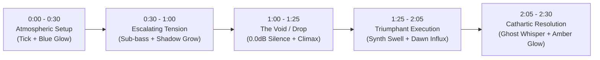

# Hooks, Retention & Pacing Architecture
*Mastering the YouTube Algorithm Through Narrative Structure*

---

## 1. The 15-Second Retention Gate

In YouTube long-form animation, 60% of audience drop-off occurs within the first 15 seconds. If the viewer leaves here, YouTube's recommendation engine marks the video as low-satisfaction and suffocates distribution.

To conquer the 15-Second Gate, Wakelit enforces **The 3-Second Rule Chain**:

| Second Range | Algorithmic Objective | Viewer Psychology | Sensory Trigger |
|---|---|---|---|
| **0:00 – 0:03** | Visual Hook & Pattern Interrupt | *"What am I looking at? This looks like high-budget cinema."* | Striking chiaroscuro visual: deep obsidian darkness broken only by a glowing 6500K blue screen. Immediate high-fidelity Foley sound (loud mechanical clock tick or phone buzz). |
| **0:03 – 0:08** | Narrative Hook & Micro-Dilemma | *"Why is he awake at 2:30 AM? What is he about to do?"* | Ayo's hand hovers over an object (phone, mouse, notebook). The clock on the wall reads 2:37 AM. |
| **0:08 – 0:15** | The Shadow Hook | *"Wait... what is that behind his chair?"* | A wisp of smoky darkness coalesces behind Ayo's shoulders. The Shade opens glowing pale-blue slit eyes. |

### The 4 Lethal Opening Sins:
1. ❌ **The Talking Intro:** *"Hey guys, welcome back to the channel. Today we're going to talk about..."* (Death on arrival. 70% drop-off).
2. ❌ **The Logo Stinger:** A 5-second spinning studio logo. (Viewers skip or leave).
3. ❌ **The Generic Quote Card:** A black screen with white text quoting Marcus Aurelius for 6 seconds. (Boring, lazy).
4. ❌ **The Slow Ambient Fade:** A 10-second fade from black with quiet wind. (Viewers assume nothing is happening).

---

## 2. Visual Curiosity Gaps & Progressive Disclosure

Curiosity is created by **withholding information that the viewer feels compelled to know**.

### Principles of Visual Curiosity:
1. **The Hidden Face / Silhouette:** Do not reveal Ayo's full facial expression immediately. Start from behind, or in silhouette, revealing only the posture of exhaustion.
2. **The Unfinished Prop:** Show a pen lying next to a page with one word written on it. The viewer subconsciously asks: *What was he trying to write?*
3. **The Approaching Threat:** Let the Shade exist in the background shadows before Ayo notices it. The audience feels suspense because they see the danger approaching before the protagonist does (Hitchcock's Bomb Theory).
4. **The Scale Expansion:** Start with an intimate close-up (a finger hovering over a glass screen), cut to a medium shot showing Ayo's isolation in the dark room, cut to a wide shot showing the gigantic shadow towering over the tiny room.

---

## 3. Pacing & The 30-Second Dynamic Pivot

Pacing is not speed; pacing is **rhythm and variation**. A video that moves at 100mph for two minutes is just as boring as a video that moves at 5mph.

### The 30-Second Auditory Rule:
Every 30 seconds, the auditory foundation must change state:
- **0:00–0:30:** Foley-forward + minimal room tone.
- **0:30–1:00:** Enter 40Hz sub-bass vibration + ticking accelerates or distorts.
- **1:00–1:20:** Sudden absolute cutoff (-50dB silence).
- **1:20–2:00:** Hans Zimmer-style atmospheric synth chord progression (C minor -> G minor -> Eb major).
- **2:00–2:30:** Solo acoustic resonance or warm drone fading into quiet morning birdsong.

---

## 4. Retaining Viewers Through The Ending (Outro Engineering)

Most YouTube creators destroy their channel retention at the end by signaling that the video is over:
- *"Thanks for watching! Don't forget to like and subscribe..."*

The moment a viewer hears or sees an ending cue, they click away, destroying end-of-video retention.

### Wakelit Outro Protocol:
1. **Zero Outro Voiceover:** Never ask for subscribers or likes verbally.
2. **Cut on Emotional Climax:** The final line of the Ghost Whisper is spoken, the camera holds on Ayo's transformed posture in the morning light for exactly 2.5 seconds, and then cuts cleanly to black.
3. **Seamless Loop Potential:** The final shot's amber light can subtly fade into the dawn, connecting thematically back to the concept of time, prompting instant rewatching or autoplay into the next Wakelit film.
